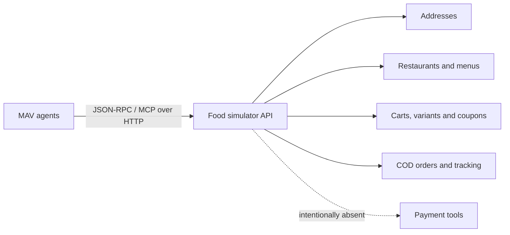

# Swiggy MCP Simulator for MAV

[](https://github.com/Shashank-K-V/swiggy-mcp-simulator/actions/workflows/ci.yml)
[](https://www.python.org/)
[](LICENSE)
[](#safety-boundary)

A standalone, local-only food-delivery environment for
[`mav-multi-agent-voice-ordering`](https://github.com/Shashank-K-V/mav-multi-agent-voice-ordering).
It mirrors the non-payment Swiggy Food MCP journey closely enough to exercise a real network and
tool boundary without a Swiggy account, restaurant, rider, payment, or delivery.

## Why this is a separate service

Keeping marketplace state outside MAV tests the same architectural concerns a live provider would
introduce: network failures, structured tool contracts, independent user sessions, cart freshness,
non-idempotent ordering, history reconciliation, and delivery tracking.



## What is included

- 12 seeded Bengaluru restaurants and 96 menu items
- saved-address create/list/delete
- restaurant and menu search
- dietary/allergen metadata, stock and restaurant availability
- menu variants and add-ons
- multi-item cart, delivery fee, tax and coupons (`SIM50`, `VEG20`)
- Cash-on-Delivery order placement only
- order history, details, status, tracking and support tickets
- separate per-user state using the `X-Sim-User` header
- MCP-compatible JSON-RPC endpoint plus test-only administration endpoints

Payment tools are intentionally absent. Every response is labelled as a simulation.

## Quick start

```bash
git clone https://github.com/Shashank-K-V/swiggy-mcp-simulator.git
cd swiggy-mcp-simulator
python3 -m venv .venv
source .venv/bin/activate
python -m pip install -e '.[dev]'
PYTHONPATH=src python3 -m swiggy_simulator.server
```

The endpoint is `http://127.0.0.1:8790/food`. Health is at `/health` and inspectable state is at `/admin/state`.

In a second Terminal window, start the already-configured MAV UI:

```bash
./run-connected-mav.sh
```

Then open `http://localhost:8766`. The UI will identify its marketplace provider as
`swiggy-http-sim`. The launcher expects LM Studio at `http://127.0.0.1:1234/v1`; change its
model variables if LM Studio exposes a different model identifier.

## Test

```bash
PYTHONPATH=src python3 -m pytest
PYTHONPATH=src python3 -m swiggy_simulator.check
```

## Heavy multi-order test

The repeatable load test creates different customers, addresses, restaurants, multi-item carts,
quantities, variants, add-ons and coupons. Every order is then checked against its fresh cart,
order details, history and tracking record.

```bash
PYTHONPATH=src python3 -m swiggy_simulator.load_test \
  --reset --customers 20 --orders-per-customer 5 --workers 10
```

That example creates and verifies 100 simulated orders. The safety limits are 200 customers,
20 orders per customer and 50 concurrent workers. Orders are distributed across placed,
confirmed, preparing, picked-up, delivered and cancelled states. This remains local and
payment-free.

The latest local stress run verified **180/180 orders**, **1,987 item units**, and six delivery
states with zero failures. These numbers describe the deterministic local simulator, not real
Swiggy capacity.

## Test-only controls

- `POST /admin/reset` with `{}` resets all users.
- `POST /admin/advance` with `{"orderId":"SIM-..."}` moves an order to its next delivery stage.
- An optional `status` can set `PLACED`, `CONFIRMED`, `PREPARING`, `PICKED_UP`, `DELIVERED`, or `CANCELLED`.

## Safety boundary

This service binds only to the local computer by default. It is not affiliated with Swiggy, does
not scrape Swiggy, and must never be represented as a production integration. Payment tools are
not exposed, Cash on Delivery is simulated, and every HTTP response is labelled as simulation data.
